# <a id="0"></a>Event Sourcing with PostgreSQL

- [Introduction](#1)
- [Example domain](#2)
- [Event sourcing and CQRS basics](#3)
  - [State-oriented persistence](#3-1)
  - [Event sourcing](#3-2)
  - [Snapshotting](#3-3)
  - [Querying the data](#3-4)
  - [CQRS](#3-5)
  - [Event handlers](#3-6)
  - [Domain events vs Integration events](#3-7)
  - [Advantages of CQRS](#3-8)
  - [Advantages of event sourcing](#3-9)
- [Solution architecture](#4)
  - [Component diagram](#4-1)
  - [ER diagram](#4-2)
  - [Optimistic concurrency control](#4-3)
  - [Snapshotting](#4-4)
  - [Loading any revision of the aggregate](#4-5)
  - [Synchronously updating projections](#4-6)
  - [Asynchronously sending integration events to a message broker](#4-7)
    - [Transactional outbox using transaction ID](#4-7-1)
    - [Transactional outbox using table-level lock](#4-7-2)
    - [Database polling](#4-7-3)
    - [Listen/Notify as an alternative to database polling](#4-7-4)
  - [Adding new asynchronous event handlers](#4-8)
  - [Drawbacks](#4-9)
  - [Production-grade enterprise features](#4-10)
    - [Command idempotency](#4-10-1)
    - [Event upcasting and schema evolution](#4-10-2)
    - [Dead letter queue and fault tolerance](#4-10-3)
    - [Zero-downtime projection rebuilding](#4-10-4)
    - [Observability and Prometheus metrics](#4-10-5)
    - [Database performance and autovacuum tuning](#4-10-6)
  - [Visual architectural diagrams](#4-11)
    - [CQRS and Event Sourcing end-to-end architecture](#4-11-1)
    - [Command execution and optimistic concurrency control sequence](#4-11-2)
    - [Transactional outbox and PostgreSQL Listen/Notify flow](#4-11-3)
    - [Order aggregate state machine](#4-11-4)
    - [Dead letter queue and admin replay sequence](#4-11-5)
- [Project structure](#5)
  - [Maven modules](#5-1)
  - [Database schema migrations](#5-2)
  - [Class diagrams](#5-3)
    - [Class diagram of the domain model](#5-3-1)
    - [Class diagram of the projections](#5-3-2)
    - [Class diagram of the service layer](#5-3-3)
- [How to adapt it to your domain?](#6)
- [How to run the sample?](#7)
  - [Step-by-step setup](#7-1)
  - [REST API testing with cURL](#7-2)
  - [Day-2 admin operations (DLQ & Projections)](#7-3)
  - [API testing with Bruno](#7-4)
  - [Running the application from IntelliJ IDEA](#7-5)

<!-- Table of contents is made with https://github.com/eugene-khyst/md-toc-cli -->

## <a id="1"></a>Introduction

Usually, our applications operate with the current state of a domain object.
But sometimes, we need to know the entire history of the domain object changes.
For example, we want to know how an order got into its current state.

The audit trail (also called the audit log) is a chronological record of the history
and details of the actions that affected the system.
An audit trail may be a regulatory or business requirement.

We can store all changes to the domain object state as a sequence of events in an append-only event stream.
Thus, event streams will contain an entire history of changes.
But how can we be sure that this history is authentic and error-free?
We can use event streams as a primary source of truth in a system.
To get the current state of an object, we have to replay all events in the order of occurrence.
This pattern is called event sourcing. The database for storing event streams is called an event store.
Event sourcing provides a complete and accurate record of all changes made to a system.
Event sourcing is an industry standard for implementing audit trail.

There are specialized databases for event sourcing.
Developer Advocates working for the companies behind these specialized databases said
you shouldn't implement event sourcing with traditional relational or document-oriented databases.
Is this true or just a marketing ploy?

Specialized databases for event sourcing are convenient and provide the necessary functionality out of the box.
But PostgreSQL, the world's most advanced open-source database, is also suitable for event sourcing.
You can use PostgreSQL as an event store without additional frameworks or extensions
instead of setting up and maintaining a separate specialized database for event sourcing.

This repository provides a reference implementation of an event-sourced system 
that uses PostgreSQL as an event store built with Spring Boot.
[Fork](https://github.com/eugene-khyst/postgresql-event-sourcing/fork) the repository and use it as a template for your projects.
Or clone the repository and run end-to-end tests to see how everything works together.


See also

* [Event Sourcing with EventStoreDB](https://github.com/eugene-khyst/eventstoredb-event-sourcing)
* [Event Sourcing with Kafka and ksqlDB](https://github.com/eugene-khyst/ksqldb-event-souring)

## <a id="2"></a>Example domain

This sample uses a simplified domain model of the ride-hailing system.

* A rider can place an order for a ride along a route specifying a price.
* A rider can edit an order price to pay more instead of waiting in cases of very high demand.
* A driver can accept an order.
* A driver can complete previously accepted order.
* An order can be canceled before completion.

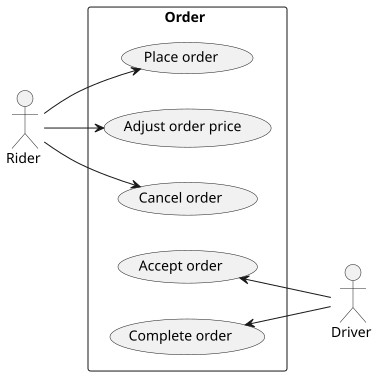

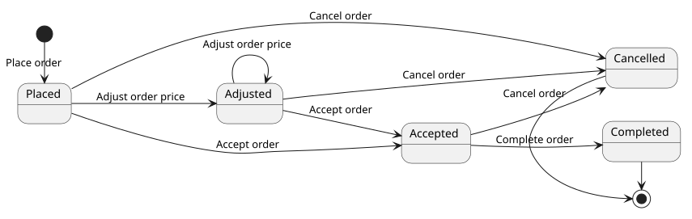

## <a id="3"></a>Event sourcing and CQRS basics

### <a id="3-1"></a>State-oriented persistence

State-oriented persistence (CRUD) applications store only the latest version of an entity.
Database records present entities.
When an entity is updated, the corresponding database record gets updated too.
SQL `INSERT`, `UPDATE` and `DELETE` statements are used.

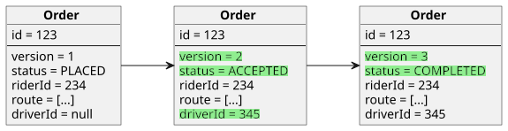

### <a id="3-2"></a>Event sourcing

Event sourcing applications persist the state of an entity as a sequence of immutable state-changing events.

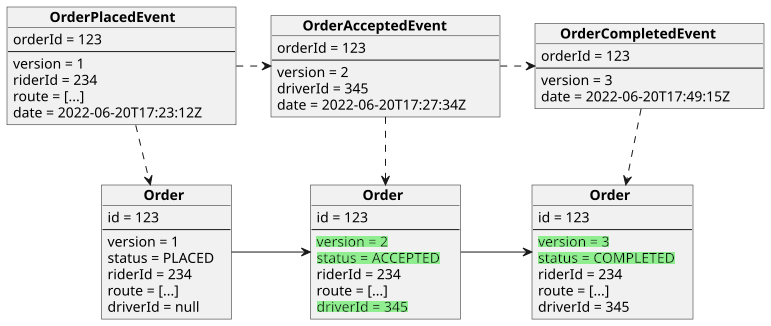

Whenever the state of an entity changes, a new event is appended to the list of events.
Only SQL `INSERT` statements are used.
Events are immutables, so SQL `UPDATE` and `DELETE` statements are not used.

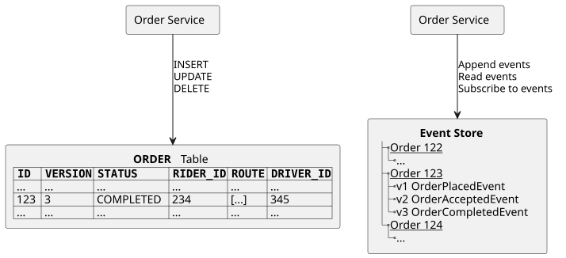

The current state of an entity can be restored by replaying all its events.

Event sourcing is closely related to domain-driven design (DDD) and shares some terminology.

An entity in event sourcing is called an **aggregate**.

A sequence of events for the same aggregate is called a **stream**.

Event sourcing is best suited for short-living entities with a small total number of
events (e.g., orders).

Restoring the state of the short-living entity by replaying all its events doesn't have any
performance impact. Thus, no optimizations for restoring state are required for short-living
entities.

For endlessly stored entities (e.g., users, bank accounts) with thousands of events restoring state
by replaying all events is not optimal, and snapshotting should be considered.

### <a id="3-3"></a>Snapshotting

Snapshotting is an optimization technique where a snapshot of the aggregate's state is also saved,
so an application can restore the current state of the aggregate from the snapshot rather than from
all the events (potentially thousands).

On every *nth* event, make an aggregate snapshot by storing an aggregate state and its version.

To restore an aggregate state:

1. first read the latest snapshot,
2. then read events forward from the original stream starting from the version pointed by the snapshot.

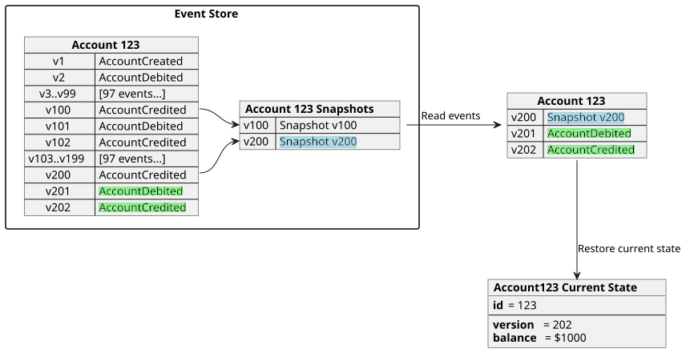

### <a id="3-4"></a>Querying the data

It's easy to find an aggregate by ID, but other queries are difficult.
Since aggregates are stored as append-only lists of immutable events,
querying the data using SQL, as we used to, is impossible.
To find an aggregate by some field, we need to first read all the events and replay them to restore all the aggregates.

To bring back all the querying power a relational database has to offer,
we can create a dedicated read model derived from the event stream.

The event stream is the write model and the primary source of truth.

The read model is a "denormalized" view of the write model, allowing faster and more convenient querying.
Read models are projections of the system state.
Therefore, read models are also known as **projections**.

Projections provide a view of data for a single aggregate type
or perform aggregations and combine data from multiple aggregate types.

That's where CQRS comes in handy.

### <a id="3-5"></a>CQRS

Command-query responsibility segregation (CQRS) stands for segregating the responsibility between
commands (write requests) and queries (read requests).
The write requests and the read requests are processed by different handlers.

A command generates zero or more events or results in an error.

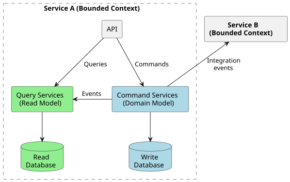

CQRS is a self-sufficient architectural pattern and doesn't require event sourcing.
But in practice, event sourcing is usually used in conjunction with CQRS.
Event store is used as a write database, and SQL or NoSQL database as a read database.

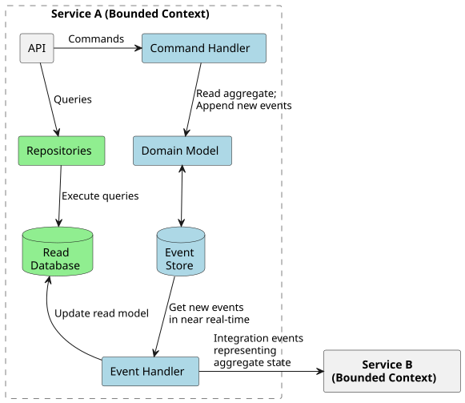

### <a id="3-6"></a>Event handlers

Commands generate events.
Event processing is done by **event handlers**.
As a part of event processing, we may need to update projections,
send a message to a message broker, or make an API call.

There are two types of event handlers: **synchronous** and **asynchronous**.

Storing the write model and read model in the same database allows for transactional updates of the read model.
Each time we append a new event, the projection is updated **synchronously** in the same transaction.
The projection is **consistent** with the event stream.

When an event handler communicates with an external system or middleware (e.g., sends a message to Kafka),
it should run **asynchronously** after the transaction updating the write model.
Asynchronous execution leads to **eventual consistency**.

Communication with external systems should not occur in the same transaction updating the write model.
The external system call may succeed, but the transaction will later be rolled back, resulting in an inconsistency.

Anyway, distributed systems should be designed with eventual consistency in mind.

### <a id="3-7"></a>Domain events vs Integration events

Events in event sourcing are **domain events**.
The domain event is a part of a bounded context and should not be used "as-is" for integration with other bounded
contexts.

For communication between bounded contexts **integration events** are used.
The integration event represents the current state of an aggregate, not just changes to the aggregate as a domain event.

### <a id="3-8"></a>Advantages of CQRS

* Independent scaling of the read and write databases.
* Optimized data schema for the read database (e.g. the read databases can be denormalized).
* Simpler queries (e.g. complex `JOIN` operations can be avoided).

### <a id="3-9"></a>Advantages of event sourcing

* A true history of the system (audit and traceability).
  An industry standard for implementing audit trail.
* Ability to put the system in any prior state (e.g. for debugging).
* New read-side projections can be created as needed (later) from events.
  It allows responding to future needs and new requirements.

## <a id="4"></a>Solution architecture

PostgreSQL can be used as an event store.
It will natively support appending events, concurrency control and reading events.
Subscribing on events requires additional implementation.

### <a id="4-1"></a>Component diagram

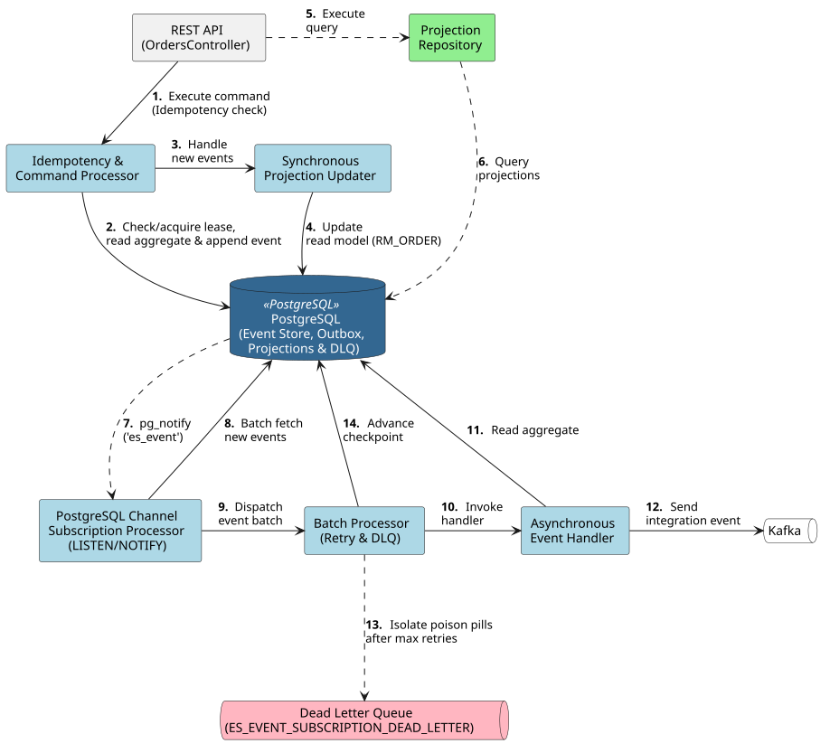

### <a id="4-2"></a>ER diagram

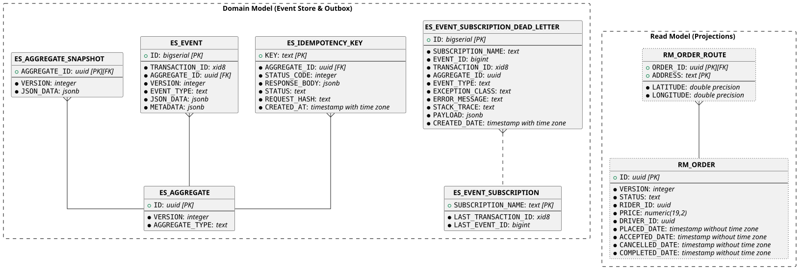

The database schema consists of the write-side event store & outbox tables and the read-side projection tables:

* **`ES_AGGREGATE`**: Root entity tracking aggregate ID, aggregate type, and current version for Optimistic Concurrency Control.
* **`ES_EVENT`**: Immutable, append-only event stream recording 64-bit PostgreSQL `TRANSACTION_ID (xid8)`, `VERSION`, `EVENT_TYPE`, payload `JSON_DATA (JSONB)`, and distributed tracing `METADATA (JSONB)`.
* **`ES_AGGREGATE_SNAPSHOT`**: Periodic aggregate snapshot table compacted via upsert (`ON CONFLICT DO UPDATE`) for accelerated aggregate rehydration.
* **`ES_IDEMPOTENCY_KEY`**: Distributed lease and request deduplication table tracking client idempotency key, aggregate ID, status code, response body, `STATUS` (`STARTED`, `COMPLETED`, `FAILED`), and SHA-256 `REQUEST_HASH`.
* **`ES_EVENT_SUBSCRIPTION`**: Transactional outbox subscription checkpoints storing `LAST_TRANSACTION_ID (xid8)` and `LAST_EVENT_ID`.
* **`ES_EVENT_SUBSCRIPTION_DEAD_LETTER`**: Poison pill isolation table preserving failed event payloads, error messages, and exception stack traces without blocking stream progress.
* **`RM_ORDER` & `RM_ORDER_ROUTE`**: Read model query projections updated synchronously upon event append.

### <a id="4-3"></a>Optimistic concurrency control

Latest aggregate version is stored in the `ES_AGGREGATE` table.
Version checking is used for optimistic concurrency control.
Version checking uses version numbers to detect conflicting updates (and to prevent lost updates).

Appending an event operation consists of 2 SQL statements in a single transaction:

1. check the actual and expected version match and increment the version
    ```sql
    UPDATE ES_AGGREGATE
       SET VERSION = :newVersion
     WHERE ID = :aggregateId
       AND VERSION = :expectedVersion
    ```
2. insert new event
    ```sql
    INSERT INTO ES_EVENT (TRANSACTION_ID, AGGREGATE_ID, VERSION, EVENT_TYPE, JSON_DATA)
    VALUES(pg_current_xact_id(), :aggregateId, :version, :eventType, :jsonObj::json)
    RETURNING ID, TRANSACTION_ID::text, EVENT_TYPE, JSON_DATA
    ```
   `pg_current_xact_id()` returns the current transaction's ID. The need for this will be explained later.

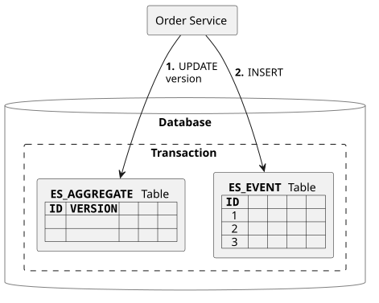

### <a id="4-4"></a>Snapshotting

On every *nth* event insert an aggregate state (snapshot) to the `ES_AGGREGATE_SNAPSHOT` table specifying the version

```sql
INSERT INTO ES_AGGREGATE_SNAPSHOT (AGGREGATE_ID, VERSION, JSON_DATA)
VALUES (:aggregateId, :version, :jsonObj::json)
```

Snapshotting for an aggregate type can be disabled and configured in the [`application.yml`](src/main/resources/application.yml)

```yaml
event-sourcing:
  snapshotting:
    # com.example.eventsourcing.domain.AggregateType
    ORDER:
      enabled: true
      # Create a snapshot on every nth event
      nth-event: 10
```

### <a id="4-5"></a>Loading any revision of the aggregate

To restore any revision of the aggregate:

1. first read the latest value of the snapshot
    ```sql
    SELECT a.AGGREGATE_TYPE,
           s.JSON_DATA
      FROM ES_AGGREGATE_SNAPSHOT s
      JOIN ES_AGGREGATE a ON a.ID = s.AGGREGATE_ID
     WHERE s.AGGREGATE_ID = :aggregateId
       AND (:version IS NULL OR s.VERSION <= :version)
     ORDER BY s.VERSION DESC
     LIMIT 1
    ```
2. then read forward from the event stream from the revision the snapshot points to
    ```sql
    SELECT ID,
           TRANSACTION_ID::text,
           EVENT_TYPE,
           JSON_DATA
      FROM ES_EVENT
     WHERE AGGREGATE_ID = :aggregateId
       AND (:fromVersion IS NULL OR VERSION > :fromVersion)
       AND (:toVersion IS NULL OR VERSION <= :toVersion)
     ORDER BY VERSION ASC
    ```

### <a id="4-6"></a>Synchronously updating projections

Using PostgreSQL as an event store and a read database allows for transactional updates of the read model.
Each time we append a new event, the projection is updated synchronously in the same transaction.
It's a big advantage because sometimes consistency is not so easy to achieve.

You can't get consistent projections when a separate database is used as an event store.

### <a id="4-7"></a>Asynchronously sending integration events to a message broker

Integration events should be sent asynchronously after the transaction updating the write model.

PostgreSQL doesn't allow subscribing on changes, so the solution is a Transactional Outbox pattern.
A service that uses a database inserts events into an outbox table as part of the local transaction.
A separate process publishes the events inserted into database to a message broker.

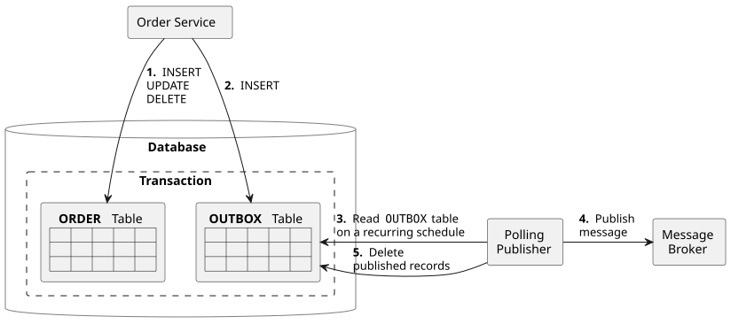

We may have multiple asynchronous event handlers or so-called subscriptions.
The subscription concept is required to keep track of delivered events separately for different event handlers.
The last event processed by the event handler (subscription) is stored in the separate table `ES_EVENT_SUBSCRIPTION`.
New events are processed by polling the `ES_EVENT` table.

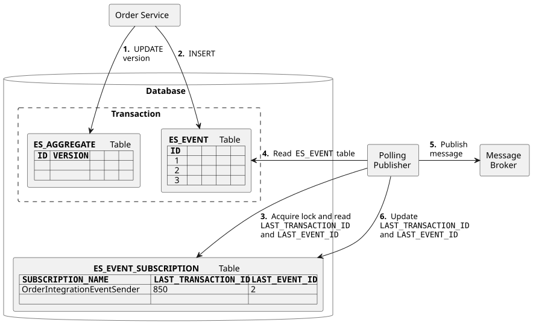

Since multiple instances of this application can run in parallel,
we need to ensure that any processing only affects the event once.
We don't want more than one event handler instance to handle the same event.

This is achieved by acquiring locks on the rows of the `ES_EVENT_SUBSCRIPTION` table.
We lock the row (`SELECT FOR UPDATE`) of the currently processed subscription.

To not hang other backend instances, we want to skip already locked rows (`SELECT FOR UPDATE SKIP LOCKED`)
and lock the "next" subscription.
It allows multiple backend instances to select different subscriptions that do not overlap.
This way, we improve availability and scalability.

The event subscription processor polls `ES_EVENT_SUBSCRIPTION` table every second (interval is configurable) for new events
and processes them:

1. read the last transaction ID and event ID processed by the subscription and acquire lock
    ```sql
    SELECT LAST_TRANSACTION_ID::text,
           LAST_EVENT_ID
      FROM ES_EVENT_SUBSCRIPTION
     WHERE SUBSCRIPTION_NAME = :subscriptionName
       FOR UPDATE SKIP LOCKED
    ```
2. read new events
    ```sql
    SELECT e.ID,
           e.TRANSACTION_ID::text,
           e.EVENT_TYPE,
           e.JSON_DATA
      FROM ES_EVENT e
      JOIN ES_AGGREGATE a on a.ID = e.AGGREGATE_ID
     WHERE a.AGGREGATE_TYPE = :aggregateType
       AND (e.TRANSACTION_ID, e.ID) > (:lastProcessedTransactionId::xid8, :lastProcessedEventId)
       AND e.TRANSACTION_ID < pg_snapshot_xmin(pg_current_snapshot())
     ORDER BY e.TRANSACTION_ID ASC, e.ID ASC
    ```
    A comparison like `(a, b) > (c, d)` is a row comparison and is equivalent to `a > c OR (a = c AND b > d)`.
3. update the last transaction ID and event ID processed by the subscription
    ```sql
    UPDATE ES_EVENT_SUBSCRIPTION
       SET LAST_TRANSACTION_ID = :lastProcessedTransactionId::xid8,
           LAST_EVENT_ID = :lastProcessedEventId
     WHERE SUBSCRIPTION_NAME = :subscriptionName
    ```

#### <a id="4-7-1"></a>Transactional outbox using transaction ID

Using only the event ID to track events processed by the subscription is unreliable 
and can result in lost events.

The `ID` column of the `ES_EVENT` table is of type `BIGSERIAL`.
It's a notational convenience for creating ID columns having their default values assigned from a `SEQUENCE` generator.

PostgreSQL sequences can't be rolled back.
`SELECT nextval('ES_EVENT_ID_SEQ')` increments and returns the sequence value.
Even if the transaction is not yet committed, the new sequence value becomes visible to other transactions. 

If transaction #2 started after transaction #1 but committed first,
the event subscription processor can read the events created by transaction #2, update the last processed event ID,
and thus lose the events created by transaction #1.

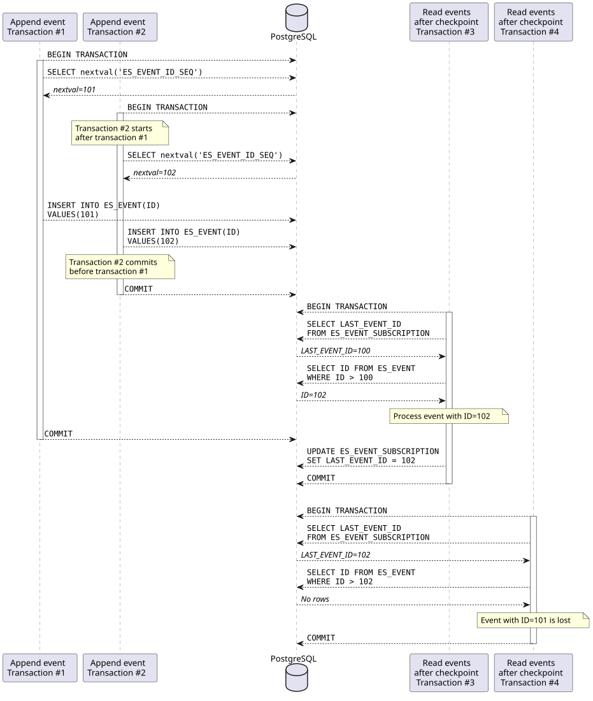

We use transaction ID with event ID to build a reliable PostgreSQL polling mechanism that doesn't lose events.

Each event is supplemented with the current transaction ID.
`pg_current_xact_id()` returns the current transaction's ID of type `xid8`.
`xid8` values increase strictly monotonically and cannot be reused in the lifetime of a database cluster.

The latest event that is "safe" to process is right before the `xmin` of the current snapshot. 
`pg_current_snapshot()` returns a current snapshot, a data structure showing which transaction IDs are now in-progress.
`pg_snapshot_xmin(pg_snapshot)` returns the `xmin` of a snapshot.
`xmin` is the lowest transaction ID that was still active. 
All transaction IDs less than `xmin` are either committed and visible, or rolled back.

Even if transaction #2 started after transaction #1 and committed first,
the events it created won't be read by the event subscription processor until transaction #1 is committed.

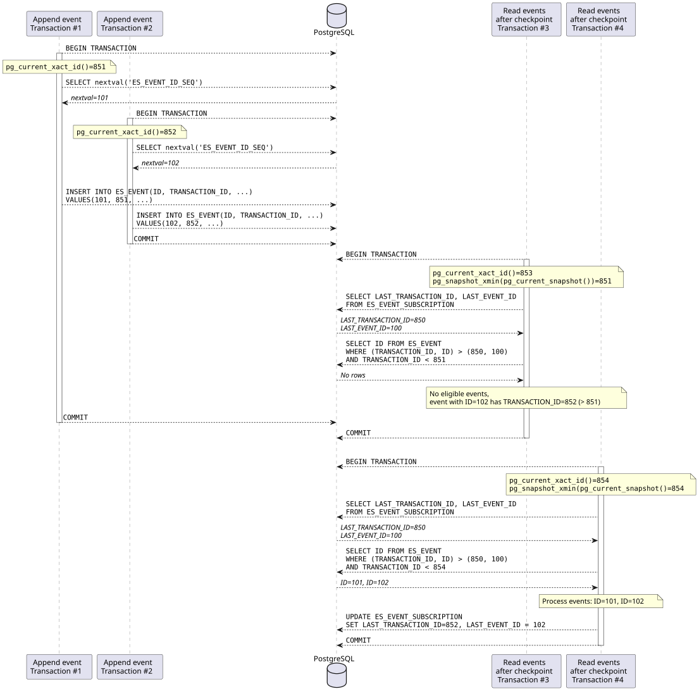

> **NOTE**  
> The transaction ID solution is used by default as it is non-blocking.

#### <a id="4-7-2"></a>Transactional outbox using table-level lock

With the transaction ID solution, event subscription processor doesn't wait for in-progress transactions to complete.
Events created by already committed transactions will not be available for processing 
while transactions started earlier are still in-progress. 
These events will be processed immediately after these earlier transactions have completed.

An alternative solution is to use PostgreSQL explicit locking to make event subscription processor wait for in-progress transactions.

Before reading new events, the event subscription processor
* gets the most recently issued ID sequence number,
* very briefly locks the table for writes to wait for all pending writes to complete.

The most recently issued `ES_EVENT_ID_SEQ` sequence number is obtained using the `pg_sequence_last_value` function:
`SELECT pg_sequence_last_value('ES_EVENT_ID_SEQ')`.

Events are created with the command `INSERT INTO ES_EVENT...` that acquires the `ROW EXCLUSIVE` lock mode on `ES_EVENT` table.
`ROW EXCLUSIVE (RowExclusiveLock)` lock mode is acquired by any command that modifies data in a table.

The command `LOCK ES_EVENT IN SHARE ROW EXCLUSIVE MODE` acquires the `SHARE ROW EXCLUSIVE` lock mode on `ES_EVENT` table.
`SHARE ROW EXCLUSIVE (ShareRowExclusiveLock)` mode protects a table against concurrent data changes, 
and is self-exclusive so that only one session can hold it at a time. 

`SHARE ROW EXCLUSIVE` lock must be acquired in a separate transaction (`Propagation.REQUIRES_NEW`).
The transaction must contain only this command and commit quickly to release the lock, so writes can resume.

When the lock is acquired and released, it means 
that there are no more uncommitted writes with an ID less than or equal to the ID returned by `pg_sequence_last_value`.

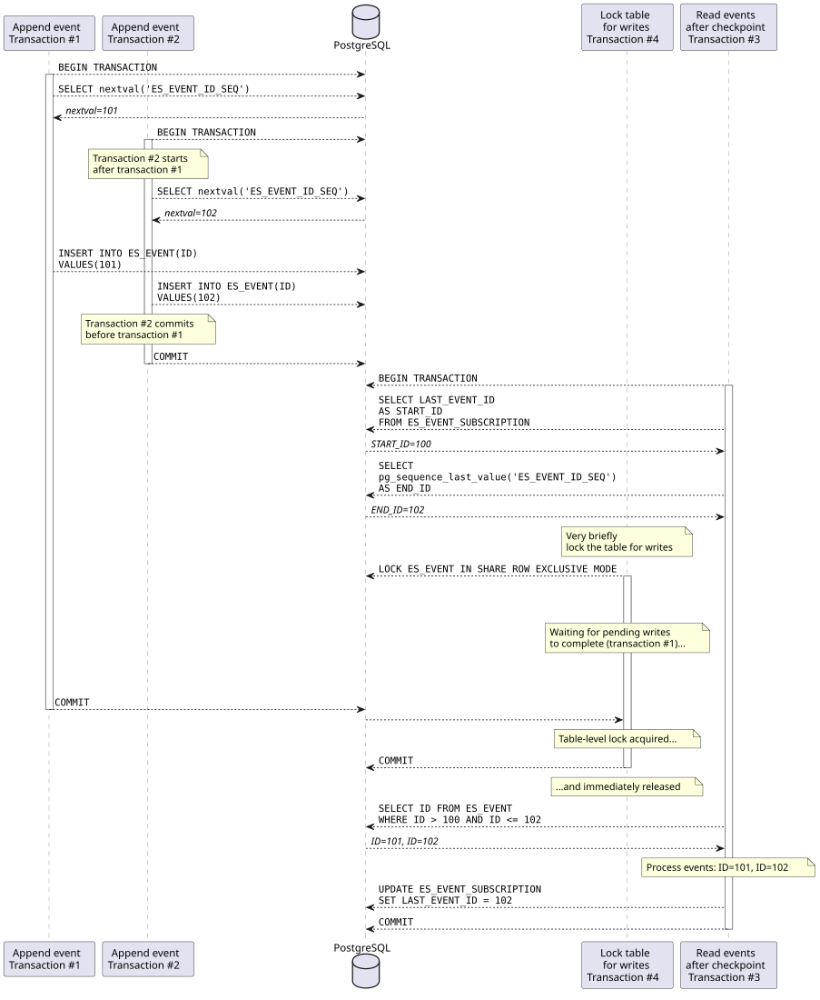

#### <a id="4-7-3"></a>Database polling

To get new events from the `ES_EVENT` table, the application has to poll the database.
The shorter the polling period, the shorter the delay between persisting a new event and processing it by the subscription. 
But the lag is inevitable. If the polling period is 1 second, then the lag is at most 1 second.

The polling mechanism implementation [ScheduledEventSubscriptionProcessor](src/main/java/com/example/eventsourcing/service/ScheduledEventSubscriptionProcessor.java)
uses a Spring annotation [@Scheduled](https://docs.spring.io/spring-framework/docs/current/javadoc-api/org/springframework/scheduling/annotation/Scheduled.html) to poll database with a fixed period.

The polling event subscription processing can be enabled and configured in the [`application.yml`](src/main/resources/application.yml)

```yaml
event-sourcing:
  subscriptions: polling # Enable database polling subscription processing
  polling-subscriptions:
    polling-initial-delay: PT1S
    polling-interval: PT1S
```

#### <a id="4-7-4"></a>Listen/Notify as an alternative to database polling

To reduce the lag associated with database polling, the polling period can be set to a very low value, 
such as 1 second.
But this means that there will be 3600 database queries per hour and 86400 per day, even if there are no new events. 

PostgreSQL `LISTEN` and `NOTIFY` feature can be used instead of polling.
This mechanism allows for sending asynchronous notifications across database connections.
Notifications are not sent directly from the application, 
but via the database [trigger](src/main/resources/db/migration/V2__notify_trigger.sql) on a table.

To use this functionality an unshared [PgConnection](https://jdbc.postgresql.org/documentation/publicapi/org/postgresql/jdbc/PgConnection.html) 
which remains open is required.
The long-lived dedicated JDBC `Connection` for receiving notifications has to be created using the `DriverManager` API, 
instead of getting from a pooled `DataSource`.

PostgreSQL JDBC driver can't receive asynchronous notifications 
and must poll the backend to check if any notifications were issued. 
A timeout can be given to the poll function `getNotifications(int timeoutMillis)`, 
but then the execution of statements from other threads will block.
When `timeoutMillis` = 0, blocks forever or until at least one notification has been received. 
It means that notification is delivered almost immediately, without a lag.
If more than one notification is about to be received, these will be returned in one batch.

This solution  significantly reduces the number of issued queries 
and also solves the lag problem that the polling solution suffers from.

The Listen/Notify mechanism implementation [PostgresChannelEventSubscriptionProcessor](src/main/java/com/example/eventsourcing/service/PostgresChannelEventSubscriptionProcessor.java)
is inspired by the Spring Integration class [PostgresChannelMessageTableSubscriber](https://github.com/spring-projects/spring-integration/blob/v6.0.0/spring-integration-jdbc/src/main/java/org/springframework/integration/jdbc/channel/PostgresChannelMessageTableSubscriber.java).

The Listen/Notify event subscription processing can be enabled in the [`application.yml`](src/main/resources/application.yml)

```yaml
event-sourcing:
  subscriptions: postgres-channel # Enable Listen/Notify event subscription processing
```

> **NOTE**  
> The Listen/Notify mechanism is used by default as it is more efficient.

### <a id="4-8"></a>Adding new asynchronous event handlers

After restarting the backend, existing subscriptions will only process new events after the last processed event 
and not everything from the first one.

> **WARNING**  
> Critical content demanding immediate user attention due to potential risks.
New subscriptions (event handlers) in the first poll will read and process all events.
Be careful, if there are too many events, they may take a long time to process.

### <a id="4-9"></a>Drawbacks

Using PostgreSQL as an event store has a lot of advantages, but there are also drawbacks.

1. **Asynchronous event handlers can process the same event more than once.** 
   It might crash after processing an event but before recording the fact that it has done so. 
   When it restarts, it will then process the same event again (e.g., send an integration event).
   Integration events are delivered with **at-least-once** delivery guarantee.
   The exactly-once delivery guarantee is hard to achieve due to a dual-write.
   A dual-write describes a situation when you need to atomically update the database and publish messages
   without two-phase commit (2PC).
   Consumers of integration events should be idempotent and filter duplicates and unordered events.
2. The asynchronous event handling results in the **eventual consistency between the write model and sent integration events**.
   The polling database table for new events with a fixed delay introduces a full consistency lag 
   greater than or equal to the interval between polls (1 second by default).
3. **A long-running transaction in the same database will effectively "pause" all event handlers.** 
   `pg_snapshot_xmin(pg_snapshot)` will return the ID of this long-running transaction
   and events created by all later transactions will be read by the event subscription processor 
   only after this long-running transaction is committed.

### <a id="4-10"></a>Production-grade enterprise features

To transform this reference architecture into an enterprise-ready foundation, six critical resilience, schema evolution, and performance subsystems have been integrated:

#### <a id="4-10-1"></a>Command idempotency (IETF RFC 9440 & Stripe Specification)

In distributed systems and microservices, client retries or network blips can cause duplicate requests. Without strict deduplication, duplicate writes occur (e.g., duplicate orders, double payments). This system implements the **IETF RFC 9440** and **Stripe/PayPal idempotency standard**:

* **Client-Driven Key**: The client generates a unique UUIDv4 and passes it via the `Idempotency-Key` HTTP header.
* **Request Fingerprinting**: The server computes a SHA-256 hash of the request URL and raw JSON payload (`REQUEST_HASH`).
* **Two-Phase Distributed Locking & Storage (`ES_IDEMPOTENCY_KEY`, Migrations V8 & V11)**:
  1. **Phase 1 (Lease Acquisition)**: [`CommandProcessor`](postgresql-event-sourcing-core/src/main/java/eventsourcing/postgresql/service/CommandProcessor.java) calls [`IdempotencyService.tryAcquireLease`](postgresql-event-sourcing-core/src/main/java/eventsourcing/postgresql/service/command/IdempotencyService.java) in an autonomous transaction (`Propagation.REQUIRES_NEW`).
     - **Cache Hit (Completed)**: If the key was already processed with the **same hash**, the cached HTTP status and body are immediately returned with `Idempotent-Replayed: true` (zero duplicate execution).
     - **Payload Tampering Mismatch**: If the key was already used with a **different payload hash**, an `IdempotencyPayloadMismatchException` is thrown, returning **`HTTP 422 Unprocessable Entity`** with error code `IDEMPOTENCY_KEY_MISMATCH`.
     - **Concurrent In-Flight Collision**: If the key is currently `STARTED` by another concurrent thread/pod, an `IdempotencyInProgressException` is thrown, returning **`HTTP 409 Conflict`** with header **`Retry-After: 1`**.
     - **New Request**: An in-flight lease is atomically inserted into `ES_IDEMPOTENCY_KEY` with status `STARTED`.
  2. **Phase 2 (Completion or Release)**:
     - **Success**: Upon successful domain processing and event commit, the lease transitions to `COMPLETED` along with the HTTP status and serialized response body.
     - **Failure**: If an unhandled exception or invariant violation occurs, the lease is immediately released (`releaseLease`), allowing the client to fix parameters and retry with the same key.

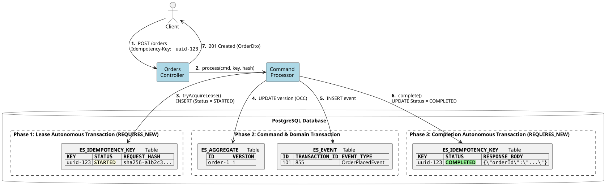

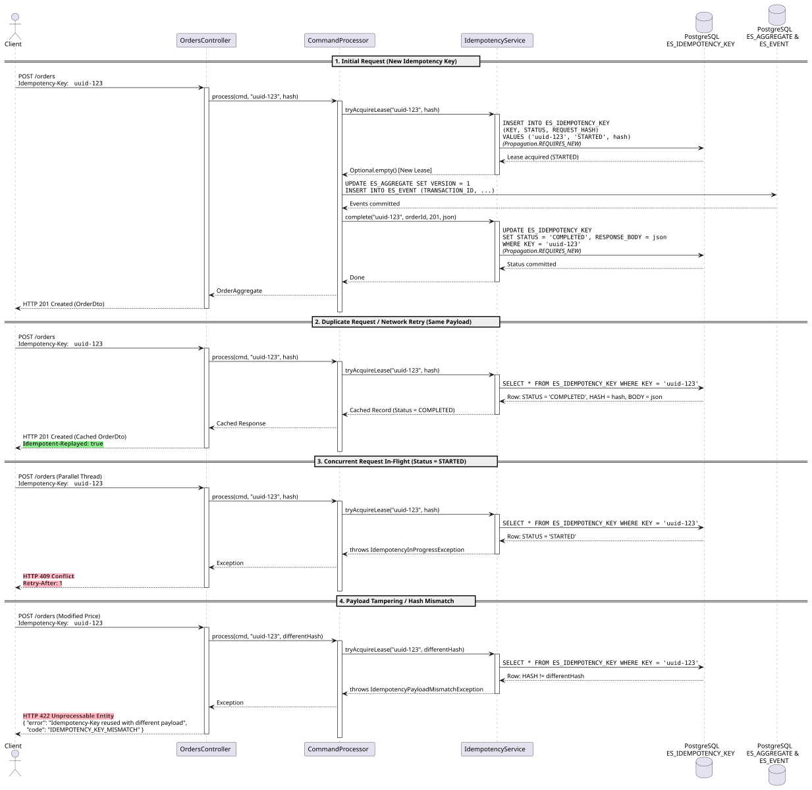

> [!TIP]
> High-value mutation operations (`POST /orders`, `PUT /orders/{id}`) should always supply an `Idempotency-Key` UUIDv4.

#### <a id="4-10-2"></a>Event upcasting and schema evolution

Event stores are append-only and immutable. However, business requirements change over time, altering event schema definitions. Updating historical events in place violates event sourcing purity.

* **Upcasting**: When older event versions are read from PostgreSQL, they are intercepted in-memory by [`EventUpcasterChain`](postgresql-event-sourcing-core/src/main/java/eventsourcing/postgresql/service/event/EventUpcasterChain.java) before aggregate state reconstitution.
* **Migration V6**: Added `METADATA JSONB` (`V6__add_event_metadata.sql`) to `ES_EVENT` for extensible payload versioning and distributed tracing metadata.
* **Example**: [`SampleOrderPriceAdjustedUpcaster`](event-sourcing-app/src/main/java/com/example/eventsourcing/domain/event/SampleOrderPriceAdjustedUpcaster.java) transforms legacy v1 price events into v2 payloads transparently without rewriting database rows.

#### <a id="4-10-3"></a>Dead letter queue and fault tolerance

Asynchronous event handlers (such as integration publishers or downstream consumers) may encounter poison pills (unparseable data) or persistent downstream system outages. If left unhandled, a single failing event would block the entire subscription stream.

* **Exponential Backoff**: [`EventSubscriptionBatchProcessor`](postgresql-event-sourcing-core/src/main/java/eventsourcing/postgresql/service/EventSubscriptionBatchProcessor.java) retries failed handlers with increasing delays (1s, 2s, 4s).
* **DLQ Isolation**: If max retries are exceeded, the event, exception class, error message, stack trace, and timestamp are inserted into `ES_EVENT_SUBSCRIPTION_DEAD_LETTER` (Flyway migration V4 `V4__subscription_dlq.sql`).
* **Stream Continuity**: The subscription checkpoint is safely advanced, ensuring healthy events continue streaming without system-wide deadlocks.
* **Day-2 Management**: [`EventSubscriptionDeadLetterService`](postgresql-event-sourcing-core/src/main/java/eventsourcing/postgresql/service/EventSubscriptionDeadLetterService.java) provides operations to inspect DLQ records (`GET /admin/subscriptions/dlq`), replay specific entries (`POST /admin/subscriptions/dlq/{id}/replay`), or purge dead records.

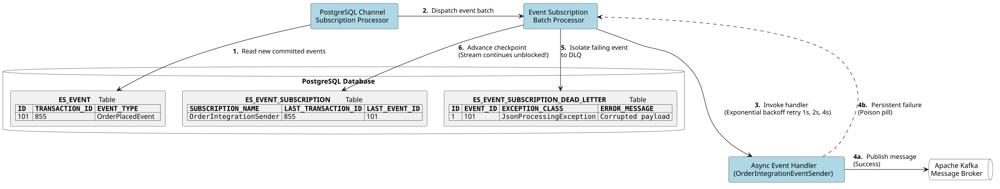

#### <a id="4-10-4"></a>Zero-downtime projection rebuilding

Read projections may drift due to bugs, require recalculation with new fields, or need rebuilding from scratch.

* [`OrderProjectionRebuildService`](event-sourcing-app/src/main/java/com/example/eventsourcing/projection/OrderProjectionRebuildService.java) provides:
  - Granular single-aggregate projection repair (`POST /admin/projections/orders/{id}/rebuild`).
  - Full stream projection rebuild (`POST /admin/projections/orders/rebuild`), streaming distinct aggregate IDs in batches and replaying events without database downtime or table locks.
* Read models maintain projection tables (`RM_ORDER` and `RM_ORDER_ROUTE`) for instant CQRS query access.

#### <a id="4-10-5"></a>Observability and Prometheus metrics

Production systems require deep visibility into event throughput, lag, and conflict rates:

* [`EventSourcingMetrics`](postgresql-event-sourcing-core/src/main/java/eventsourcing/postgresql/metrics/EventSourcingMetrics.java) exports standard Micrometer/Prometheus metrics:
  - `event_sourcing_events_appended_total`: Counter tracking total events appended across aggregate types.
  - `event_sourcing_occ_conflicts_total`: Counter monitoring Optimistic Concurrency Control collisions.
  - `event_sourcing_dlq_events_total`: Counter tracking poison pills routed to DLQ.
  - `event_sourcing_subscription_lag`: Gauge measuring the distance between the newest event ID in `ES_EVENT` and `ES_EVENT_SUBSCRIPTION.LAST_EVENT_ID`.
  - `event_sourcing_event_append_duration_seconds`: Histogram measuring write latency.
  - `event_sourcing_subscription_batch_duration_seconds`: Histogram measuring async processing batch latency.

#### <a id="4-10-6"></a>Database performance and autovacuum tuning

PostgreSQL requires deliberate tuning for append-only, high-write event stores:

* **Migration V9 (`V9__performance_tuning.sql`)**:
  - `autovacuum_vacuum_scale_factor = 0.05` & `autovacuum_analyze_scale_factor = 0.02`: Decreases vacuum thresholds from the default 20% down to 5%, preventing transaction ID wraparound and table bloat on high-volume event tables.
  - `fillfactor = 100` on `ES_EVENT`: Because events are strictly append-only and never updated, setting fillfactor to 100% maximizes storage page density and cache efficiency.
  - Compound Index `IDX_ES_EVENT_TRANSACTION_ID_ID (TRANSACTION_ID, ID)`: Optimizes composite row comparison `(TRANSACTION_ID, ID) > (:lastTxId, :lastId)` for lightning-fast batch pagination without full table scans.

---

### <a id="4-11"></a>Visual architectural diagrams

The following diagrams illustrate the core architectural concepts, control flows, and state machines implemented in this system, drawn with PlantUML and rendered in the repository's original SVG style:

#### <a id="4-11-1"></a>CQRS and Event Sourcing end-to-end architecture

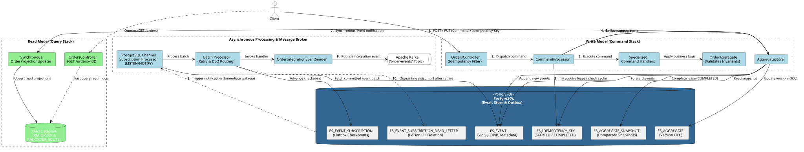

#### <a id="4-11-2"></a>Command execution and optimistic concurrency control sequence

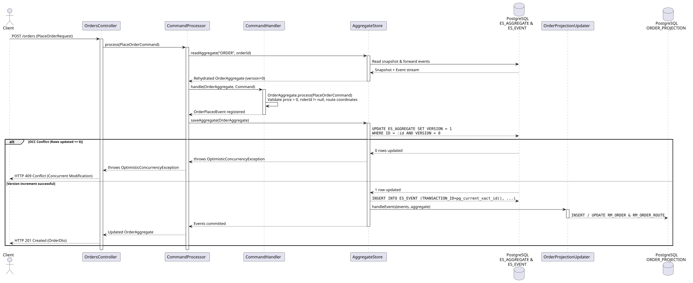

#### <a id="4-11-3"></a>Transactional outbox and PostgreSQL Listen/Notify flow

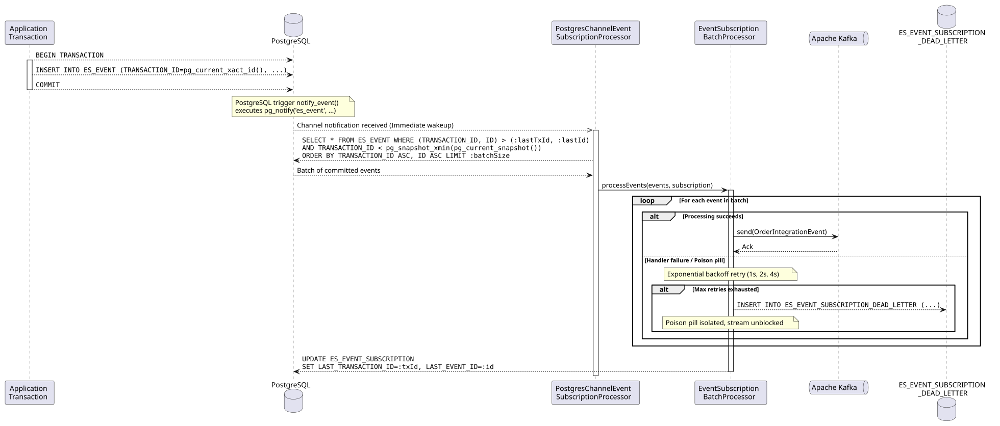

#### <a id="4-11-4"></a>Order aggregate state machine


#### <a id="4-11-5"></a>Dead letter queue and admin replay sequence

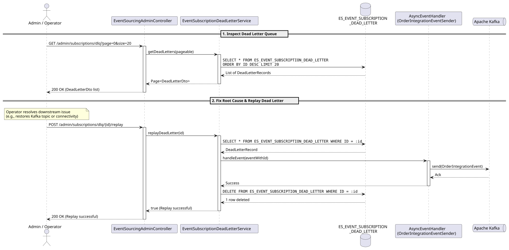

## <a id="5"></a>Project structure

### <a id="5-1"></a>Maven modules

This reference implementation can be easily extended to comply with your domain model.

Event sourcing related code and application specific code are located in separate Maven modules:
* [`postgresql-event-sourcing-core`](postgresql-event-sourcing-core): event sourcing and PostgreSQL related code, a shared library, `eventsourcing.postgresql` package,
* [`event-sourcing-app`](event-sourcing-app): application specific code, a simplified ride-hailing sample, `com.example.eventsourcing` package.

`event-sourcing-app` depends on `postgresql-event-sourcing-core`:
```xml
<dependency>
    <groupId>com.example</groupId>
    <artifactId>postgresql-event-sourcing-core</artifactId>
</dependency>
```

### <a id="5-2"></a>Database schema migrations

The database schema is managed via Flyway across 11 incremental, production-hardened migrations:

* [V1__eventsourcing_tables.sql](event-sourcing-app/src/main/resources/db/migration/V1__eventsourcing_tables.sql) &mdash; Core event store tables (`ES_AGGREGATE`, `ES_EVENT` with 64-bit `xid8 TRANSACTION_ID`, `ES_EVENT_SUBSCRIPTION`).
* [V2__notify_trigger.sql](event-sourcing-app/src/main/resources/db/migration/V2__notify_trigger.sql) &mdash; PostgreSQL `notify_event()` trigger function executing `pg_notify('es_event', ...)` on every committed event.
* [V3__projection_tables.sql](event-sourcing-app/src/main/resources/db/migration/V3__projection_tables.sql) &mdash; Read model query tables (`RM_ORDER`, `RM_ORDER_ROUTE`).
* [V4__subscription_dlq.sql](event-sourcing-app/src/main/resources/db/migration/V4__subscription_dlq.sql) &mdash; Poison pill isolation table (`ES_EVENT_SUBSCRIPTION_DEAD_LETTER`).
* [V5__migrate_to_jsonb.sql](event-sourcing-app/src/main/resources/db/migration/V5__migrate_to_jsonb.sql) &mdash; Migration of event and snapshot payloads from `JSON` to `JSONB` for indexing and query efficiency.
* [V6__add_event_metadata.sql](event-sourcing-app/src/main/resources/db/migration/V6__add_event_metadata.sql) &mdash; Adds `METADATA JSONB` column to `ES_EVENT` for tracing and schema versioning.
* [V7__snapshot_compaction.sql](event-sourcing-app/src/main/resources/db/migration/V7__snapshot_compaction.sql) &mdash; Aggregate snapshot table (`ES_AGGREGATE_SNAPSHOT`) with upsert compaction (`ON CONFLICT DO UPDATE`).
* [V8__idempotency_keys.sql](event-sourcing-app/src/main/resources/db/migration/V8__idempotency_keys.sql) &mdash; API request deduplication table (`ES_IDEMPOTENCY_KEY`).
* [V9__performance_tuning.sql](event-sourcing-app/src/main/resources/db/migration/V9__performance_tuning.sql) &mdash; PostgreSQL engine tuning (`autovacuum_vacuum_scale_factor = 0.05`, `fillfactor = 100`, composite pagination index).
* [V10__index_cleanup.sql](event-sourcing-app/src/main/resources/db/migration/V10__index_cleanup.sql) &mdash; Drops redundant indexes and optimizes DLQ pagination index.
* [V11__idempotency_ietf_enhancement.sql](event-sourcing-app/src/main/resources/db/migration/V11__idempotency_ietf_enhancement.sql) &mdash; Adds `STATUS` (`STARTED`, `COMPLETED`, `FAILED`) and `REQUEST_HASH` (SHA-256) to `ES_IDEMPOTENCY_KEY`, enabling distributed concurrent in-flight leases, payload fingerprint verification (IETF RFC 9440 & Stripe specification), and duplicate response caching.

### <a id="5-3"></a>Class diagrams

#### <a id="5-3-1"></a>Class diagram of the domain model

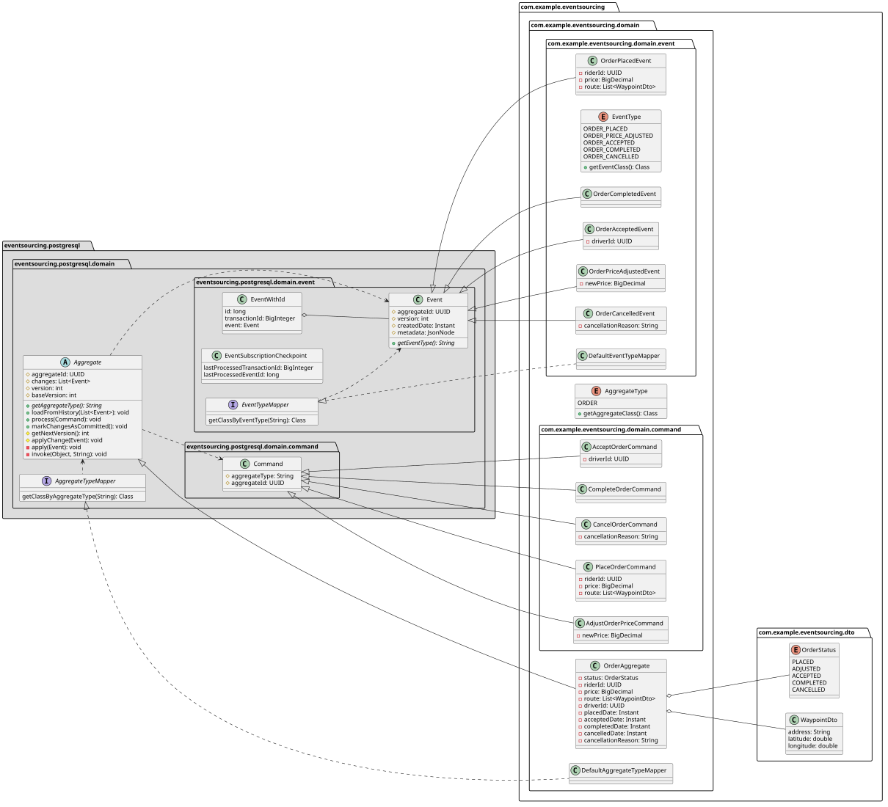

#### <a id="5-3-2"></a>Class diagram of the projections

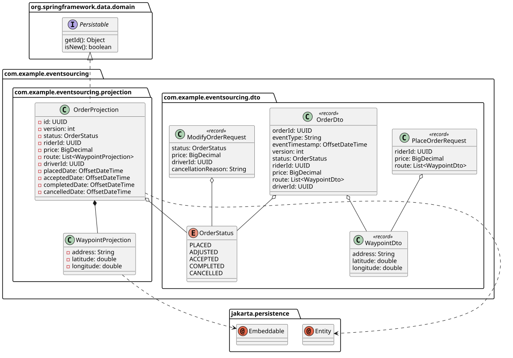

#### <a id="5-3-3"></a>Class diagram of the service layer

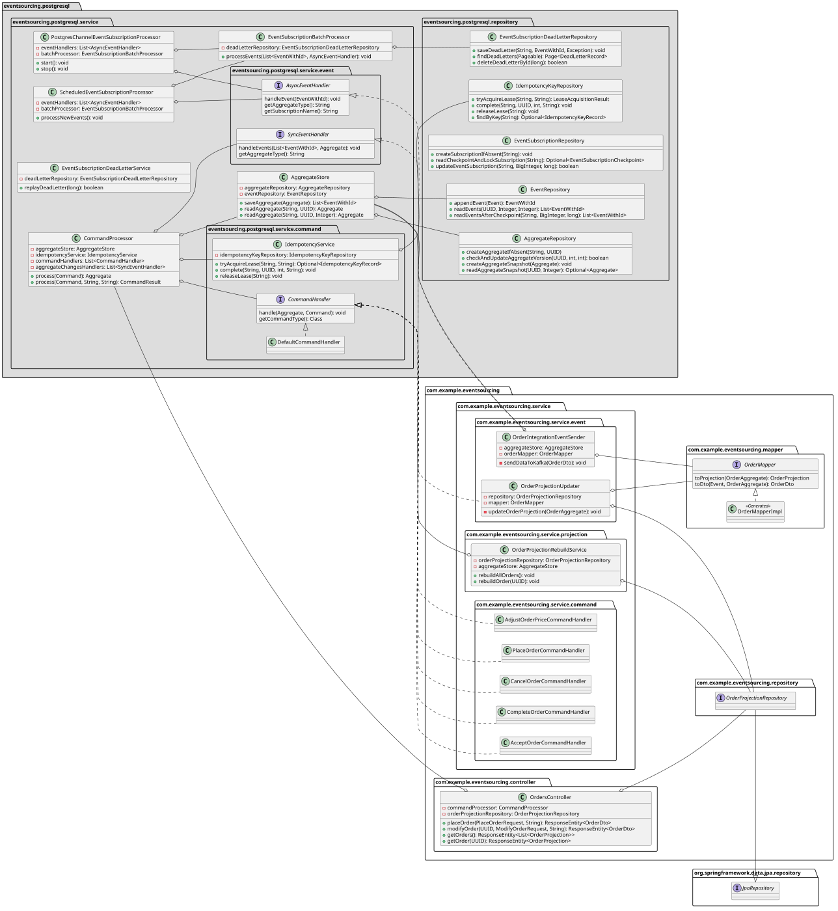

## <a id="6"></a>How to adapt it to your domain?

To adapt this sample to your domain model, make changes to `event-sourcing-app` subproject.
No changes to `postgresql-event-sourcing-core` subproject are required.

## <a id="7"></a>How to run the sample?

### <a id="7-1"></a>Step-by-step setup

1. Download & install [SDKMAN!](https://sdkman.io/install).

2. Install JDK 25
    ```bash
    sdk list java
    sdk install java 25-tem
    ```
   Make sure `JAVA_HOME` points to it, the project is compiled with `--release 25`:
    ```bash
    export JAVA_HOME="$HOME/.sdkman/candidates/java/25-tem"
    ./mvnw -v
    ```

3. Install [Docker](https://docs.docker.com/engine/install/)
   and [Docker Compose](https://docs.docker.com/compose/install/).

4. Build Java project and Docker image
    ```bash
    # `install` (not `package`) is required: the Jib build below resolves the
    # postgresql-event-sourcing-core module from the local Maven repository
    ./mvnw clean install
    # Jib does not pull the base image on its own
    docker pull eclipse-temurin:25-jre
    ./mvnw compile jib:dockerBuild -pl event-sourcing-app
    ```

5. Run PostgreSQL, Kafka and event-sourcing-app
    ```bash
    docker compose up -d
    # wait a few minutes
    ```
   To run two instances of the application, to exercise the transactional outbox
   and the optimistic concurrency control across several JVMs:
    ```bash
    docker compose up -d --scale event-sourcing-app=2
    ```

6. Follow the logs of the application
    ```bash
    docker compose logs -f event-sourcing-app
    ```
   
7. Run tests (45 unit & integration tests)
    ```bash
    ./mvnw clean test
    ```

8. Run E2E tests and see the output
    ```bash
    E2E_TESTING=true ./mvnw test -pl event-sourcing-app -Dtest=PostgresEventSourcingApplicationE2ETests
    ```

9. Explore the database using Adminer at http://localhost:8181.
   Find the database name, user, and password in [docker-compose.yml](docker-compose.yml).

### <a id="7-2"></a>REST API testing with cURL

1. Install [curl](https://curl.se/) and [jq](https://stedolan.github.io/jq/)
    ```bash
    sudo apt install curl jq
    ```

2. Place new order (with idempotent key)
    ```bash
    ORDER_ID=$(curl -s -X POST http://localhost:8080/orders \
      -H 'Content-Type: application/json' \
      -H 'Idempotency-Key: a1b2c3d4-e5f6-7890-abcd-ef1234567890' \
      -d '{
        "riderId": "63770803-38f4-4594-aec2-4c74918f7165",
        "price": "120.00",
        "route": [
          {"address": "Kyiv, 17A Polyarna Street", "lat": 50.51980, "lon": 30.46719},
          {"address": "Kyiv, 18V Novokostyantynivska Street", "lat": 50.48509, "lon": 30.48517}
        ]
      }' | jq -r .orderId)
    echo "Created Order ID: $ORDER_ID"
    ```

3. Query the placed order read projection
    ```bash
    curl -s -X GET http://localhost:8080/orders/$ORDER_ID | jq
    ```

4. Adjust the order price (e.g. surge pricing)
    ```bash
    curl -s -X PUT http://localhost:8080/orders/$ORDER_ID \
      -H 'Content-Type: application/json' \
      -d '{"status": "ADJUSTED", "price": "150.00"}' | jq
    ```

5. Accept the order with a driver
    ```bash
    curl -s -X PUT http://localhost:8080/orders/$ORDER_ID \
      -H 'Content-Type: application/json' \
      -d '{"status": "ACCEPTED", "driverId": "2c068a1a-9263-433f-a70b-067d51b98378"}' | jq
    ```

6. Complete the order
    ```bash
    curl -s -X PUT http://localhost:8080/orders/$ORDER_ID \
      -H 'Content-Type: application/json' \
      -d '{"status": "COMPLETED"}' | jq
    ```

7. Attempt invalid cancellation on completed order (verifies domain invariant rejection)
    ```bash
    curl -s -X PUT http://localhost:8080/orders/$ORDER_ID \
      -H 'Content-Type: application/json' \
      -d '{"status": "CANCELLED", "reason": "Passenger changed mind"}' | jq
    ```

8. Inspect published integration events in Kafka
    ```bash
    docker compose exec kafka /bin/kafka-console-consumer \
      --bootstrap-server localhost:9092 \
      --topic order-events \
      --from-beginning \
      --property print.key=true \
      --timeout-ms 10000
    ```

### <a id="7-3"></a>Day-2 admin operations (DLQ & Projections)

1. View poisoned events in Dead Letter Queue (DLQ):
    ```bash
    curl -s -X GET http://localhost:8080/admin/subscriptions/dlq | jq
    ```

2. Replay a dead-letter event after resolving downstream dependency:
    ```bash
    curl -s -X POST http://localhost:8080/admin/subscriptions/dlq/1/replay | jq
    ```

3. Rebuild an individual order read projection from the event stream:
    ```bash
    curl -s -X POST http://localhost:8080/admin/projections/orders/$ORDER_ID/rebuild | jq
    ```

4. Full projection stream rebuild:
    ```bash
    curl -s -X POST http://localhost:8080/admin/projections/orders/rebuild | jq
    ```

5. Scrape Prometheus observability metrics:
    ```bash
    curl -s -X GET http://localhost:8080/actuator/prometheus | grep event_sourcing
    ```

6. Browse the Kafka topics with the Kafka UI:
    ```bash
    docker compose up -d kafka-ui
    ```
    Then open http://localhost:8082 - the `order-events` topic holds the
    integration events published by the transactional outbox.

### <a id="7-4"></a>API testing with Bruno

The [bruno](bruno) folder contains a [Bruno](https://www.usebruno.com/) collection
that covers the whole REST surface: the happy path, the idempotency contract
(IETF RFC 9440 / Stripe), the bean validation errors, the domain invariants of
the order aggregate, the admin endpoints and the actuator metrics.

1. Import the collection: Bruno -> File -> Import Collection -> select the
   `bruno` folder, then select the `Local` environment.

2. Run the whole collection from the command line:
    ```bash
    npm install -g @usebruno/cli
    cd bruno
    bru run --env Local
    ```
    It reports 57 requests and 110 assertions, and it is re-runnable: the happy
    path creates a new order on every run.

| Folder | What it covers |
| --- | --- |
| `01 - Happy Path` | Create order, query it, adjust price, accept, complete, cancel |
| `02 - Idempotency` | Replay, key mismatch, `PUT` idempotency, missing key |
| `03 - Validation Errors` | Missing fields, non-positive price, invalid coordinates |
| `04 - Domain Invariants` | Illegal state transitions of the order aggregate |
| `05 - Not Found & Malformed` | Unknown ids, malformed UUIDs and JSON payloads |
| `06 - Admin & Operations` | Projection rebuild, dead letter queue |
| `07 - Actuator Monitoring` | Health, metrics, subscription lag, Prometheus scrape |

### <a id="7-5"></a>Running the application from IntelliJ IDEA

The project ships a shared run configuration in
[.idea/runConfigurations](.idea/runConfigurations), so there is nothing to set
up manually.

1. Start the infrastructure the application connects to (the application
   containers are not needed, and they would compete for port 8080):
    ```bash
    docker compose up -d postgres kafka
    ```

2. Open the project in IntelliJ IDEA and let it import the Maven project
   (the `event-sourcing-app` module is the one that contains the main class).

3. Run -> Edit Configurations... -> select `PostgresEventSourcingApplication` ->
    Run.

The configuration starts `com.example.eventsourcing.PostgresEventSourcingApplication`
with the environment variables of the Docker Compose stack:

| Variable | Value |
| --- | --- |
| `SPRING_DATASOURCE_URL` | `jdbc:postgresql://localhost:5432/postgres` |
| `SPRING_DATASOURCE_USERNAME` | `admin` |
| `SPRING_DATASOURCE_PASSWORD` | `s3cr3t` |
| `SPRING_KAFKA_BOOTSTRAPSERVERS` | `localhost:9092` |

The application is then available on http://localhost:8080, the same URL the
`curl` examples of the previous sections use.

Notes:

- If the module of the run configuration is shown as unresolved, pick
  `event-sourcing-app` in the "Use classpath of module" dropdown.
- The project uses Lombok and MapStruct, so annotation processing has to be
  enabled (Settings -> Build, Execution, Deployment -> Compiler -> Annotation
  Processors -> Enable annotation processing). The Maven import enables it
  automatically.
- To run against the `polling` subscription mode instead of the default
  `postgres-channel` one, add `-Devent-sourcing.subscriptions=polling` to the
  VM options of the run configuration.

| Port | Service |
| --- | --- |
| 8080 | The application (or the nginx load balancer in front of the containers) |
| 8082 | Kafka UI |
| 8181 | Adminer |
| 5432 | PostgreSQL |
| 9092 | Kafka |
