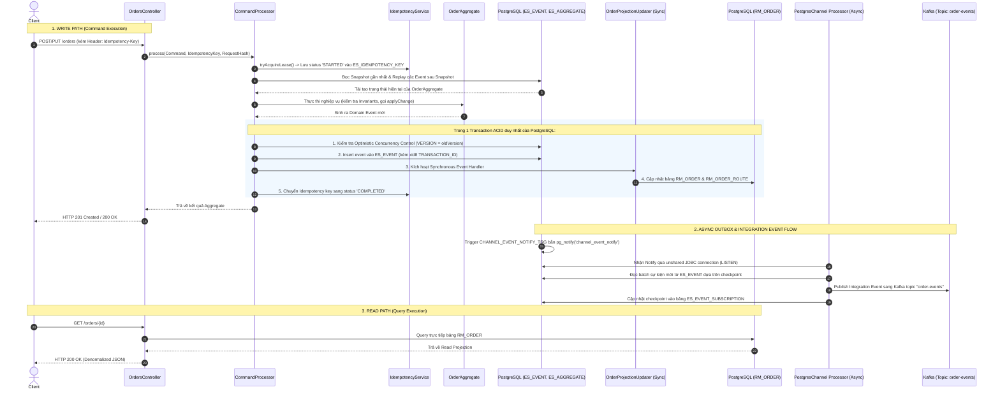

# Hướng Dẫn Chạy Toàn Bộ Hệ Thống & Kiểm Chứng Luồng Dữ Liệu (End-to-End Flow Guide)

Tài liệu này cung cấp hướng dẫn chi tiết từ A-Z về:
1. Cách thiết lập và khởi chạy toàn bộ hệ sinh thái (PostgreSQL, Kafka, Kafka UI, Adminer, Nginx và Spring Boot Service).
2. Cách quan sát và kiểm chứng từng chặng của luồng xử lý: **CQRS**, **Event Sourcing**, **Transactional Outbox (PostgreSQL Listen/Notify)**, **Read Projections**, **Optimistic Concurrency Control (OCC)**, **Snapshotting**, **Idempotency** và **Dead Letter Queue (DLQ)**.

---

## Mục lục
- [1. Sơ đồ Luồng Hoạt động Tổng quan (End-to-End Flow)](#1-sơ-đồ-luồng-hoạt-động-tổng-quan-end-to-end-flow)
- [2. Yêu cầu môi trường (Prerequisites)](#2-yêu-cầu-môi-trường-prerequisites)
- [3. Hướng dẫn Khởi chạy Hệ thống](#3-hướng-dẫn-khởi-chạy-hệ-thống)
  - [Cách 1: Chạy Full Stack qua Docker Compose (Khuyên dùng)](#cách-1-chạy-full-stack-qua-docker-compose-khuyên-dùng)
  - [Cách 2: Chạy Dev / Hybrid Mode (Debug trên máy host)](#cách-2-chạy-dev--hybrid-mode-debug-trên-máy-host)
- [4. Danh sách Port & Các Dashboard Trực quan](#4-danh-sách-port--các-dashboard-trực-quan)
- [5. Kịch bản Từng bước Kiểm chứng Toàn bộ Luồng Dữ liệu](#5-kịch-bản-từng-bước-kiểm-chứng-toàn-bộ-luồng-dữ-liệu)
  - [Bước 1: Tạo đơn hàng mới (`POST /orders`)](#bước-1-tạo-đơn-hàng-mới-post-orders)
  - [Bước 2: Đọc dữ liệu Read Model (`GET /orders/{id}`)](#bước-2-đọc-dữ-liệu-read-model-get-ordersid)
  - [Bước 3: Điều chỉnh giá cước (`PUT /orders/{id}`)](#bước-3-điều-chỉnh-giá-cước-put-ordersid)
  - [Bước 4: Tài xế nhận cuốc (`ACCEPTED`)](#bước-4-tài-xế-nhận-cuốc-accepted)
  - [Bước 5: Hoàn thành chuyến đi (`COMPLETED`)](#bước-5-hoàn-thành-chuyến-đi-completed)
  - [Bước 6: Kiểm chứng Domain Invariants & RFC 9457 Error](#bước-6-kiểm-chứng-domain-invariants--rfc-9457-error)
- [6. Kiểm chứng các Cơ chế Nâng cao (Enterprise Features)](#6-kiểm-chứng-các-cơ-chế-nâng-cao-enterprise-features)
  - [A. Chống lặp lệnh Idempotency (IETF RFC 9440 & Stripe)](#a-chống-lặp-lệnh-idempotency-ietf-rfc-9440--stripe)
  - [B. Cơ chế Snapshotting tự động](#b-cơ-chế-snapshotting-tự-động)
  - [C. Zero-downtime Projection Rebuild (Tái tạo Read Model)](#c-zero-downtime-projection-rebuild-tái-tạo-read-model)
  - [D. Dead Letter Queue (DLQ) & Admin Replay](#d-dead-letter-queue-dlq--admin-replay)
- [7. Kiểm thử Tự động E2E](#7-kiểm-thử-tự-động-e2e)

---

## 1. Sơ đồ Luồng Hoạt động Tổng quan (End-to-End Flow)

Hệ thống kết hợp **CQRS (Command Query Responsibility Segregation)** và **Event Sourcing** với PostgreSQL làm Event Store duy nhất:



---

## 2. Yêu cầu môi trường (Prerequisites)

- **Java Development Kit (JDK)**: Phiên bản **25** (Eclipse Temurin 25 khuyến nghị).
- **Docker** & **Docker Compose**: Đã cài đặt và đang chạy (Docker Desktop trên Windows cần bật WSL 2 backend).
- **Git** & **cURL** (hoặc PowerShell 7+).

---

## 3. Hướng dẫn Khởi chạy Hệ thống

### Cách 1: Chạy Full Stack qua Docker Compose (Khuyên dùng)

Cách này sẽ đóng gói và chạy toàn bộ dịch vụ trong Docker containers:

#### Trên Windows (PowerShell):
```powershell
# 1. Compile và cài đặt thư viện core vào local maven cache
.\mvnw.cmd clean install -DskipTests

# 2. Tải base image JRE 25 cho Jib plugin
docker pull eclipse-temurin:25-jre

# 3. Build Docker image cho module ứng dụng
.\mvnw.cmd compile jib:dockerBuild -pl event-sourcing-app

# 4. Khởi động toàn bộ cụm container (Postgres, Kafka, Kafka UI, Adminer, Nginx, App)
docker compose up -d
```

#### Trên Linux / macOS (Bash):
```bash
./mvnw clean install -DskipTests
docker pull eclipse-temurin:25-jre
./mvnw compile jib:dockerBuild -pl event-sourcing-app
docker compose up -d
```

Kiểm tra trạng thái các container:
```bash
docker compose ps
```
*Đợi khoảng 30s - 1 phút để `postgres` và `kafka` chuyển sang trạng thái `healthy`.*

Theo dõi log ứng dụng:
```bash
docker compose logs -f event-sourcing-app
```

---

### Cách 2: Chạy Dev / Hybrid Mode (Debug trên máy host)

Dành cho nhà phát triển muốn debug, đặt breakpoint trong IDE (IntelliJ IDEA / VS Code) hoặc chạy code trực tiếp không cần build lại image:

1. **Khởi động hạ tầng phụ trợ (Database, Broker, UI):**
   ```bash
   docker compose up -d postgres adminer kafka kafka-ui
   ```

2. **Chạy ứng dụng Spring Boot trên máy host:**
   - **Windows:** `.\mvnw.cmd spring-boot:run -pl event-sourcing-app`
   - **Linux/macOS:** `./mvnw spring-boot:run -pl event-sourcing-app`
   - *Hoặc mở class `PostgresEventSourcingApplication.java` trong IntelliJ IDEA và chọn Run.*

---

## 4. Danh sách Port & Các Dashboard Trực quan

| Giao diện / Dịch vụ | Địa chỉ URL | Thông tin đăng nhập | Mục đích quan sát |
| :--- | :--- | :--- | :--- |
| **REST API & Nginx** | [http://localhost:8080](http://localhost:8080) | Không | Điểm tiếp nhận request chính của hệ thống |
| **Adminer (Database UI)** | [http://localhost:8181](http://localhost:8181) | Hệ QT: **PostgreSQL**<br>Server: **postgres** (hoặc `localhost` nếu chạy ngoài Docker)<br>User: `admin`<br>Password: `s3cr3t`<br>Database: `postgres` | **Quan sát Write Model & Read Model**: bảng `ES_EVENT`, `ES_AGGREGATE`, `ES_AGGREGATE_SNAPSHOT`, `ES_IDEMPOTENCY_KEY`, `RM_ORDER`, `ES_EVENT_SUBSCRIPTION` |
| **Kafka UI** | [http://localhost:8082](http://localhost:8082) | Không | **Quan sát Outbox Integration Events**: xem trực tiếp message được gửi vào topic `order-events` |
| **Prometheus Metrics** | [http://localhost:8080/actuator/prometheus](http://localhost:8080/actuator/prometheus) | Không | Quan sát metrics: độ trễ outbox lag, số events đã ghi, số lần OCC collision |

---

## 5. Kịch bản Từng bước Kiểm chứng Toàn bộ Luồng Dữ liệu

Hãy mở song song 3 màn hình:
1. **Adminer UI** tại [http://localhost:8181](http://localhost:8181).
2. **Kafka UI** tại [http://localhost:8082](http://localhost:8082) (vào topic `order-events`).
3. **Cửa sổ dòng lệnh** (PowerShell hoặc Terminal).

---

### Bước 1: Tạo đơn hàng mới (`POST /orders`)

#### PowerShell:
```powershell
$headers = @{
    "Content-Type" = "application/json"
    "Idempotency-Key" = "a1b2c3d4-e5f6-7890-abcd-ef1234567890"
}
$body = @'
{
  "riderId": "63770803-38f4-4594-aec2-4c74918f7165",
  "price": "120.00",
  "route": [
    {"address": "Hanoi, Hoan Kiem", "lat": 21.028511, "lon": 105.854444},
    {"address": "Hanoi, West Lake", "lat": 21.058333, "lon": 105.823611}
  ]
}
'@

$res = Invoke-RestMethod -Uri "http://localhost:8080/orders" -Method Post -Headers $headers -Body $body
$orderId = $res.orderId
Write-Host "Created Order ID: $orderId"
```

#### cURL (Bash):
```bash
ORDER_ID=$(curl -s -X POST http://localhost:8080/orders \
  -H 'Content-Type: application/json' \
  -H 'Idempotency-Key: a1b2c3d4-e5f6-7890-abcd-ef1234567890' \
  -d '{
    "riderId": "63770803-38f4-4594-aec2-4c74918f7165",
    "price": "120.00",
    "route": [
      {"address": "Hanoi, Hoan Kiem", "lat": 21.028511, "lon": 105.854444},
      {"address": "Hanoi, West Lake", "lat": 21.058333, "lon": 105.823611}
    ]
  }' | jq -r .orderId)
echo "Created Order ID: $ORDER_ID"
```

#### 🔍 Kiểm tra kết quả:
1. **Trong Adminer (`http://localhost:8181`)**:
   - `ES_AGGREGATE`: Xuất hiện 1 dòng với `ID = $orderId`, `VERSION = 1`, `AGGREGATE_TYPE = 'ORDER'`.
   - `ES_EVENT`: Xuất hiện event đầu tiên với `EVENT_TYPE = 'ORDER_PLACED'`, `VERSION = 1`, chứa dữ liệu trong `JSON_DATA`.
   - `RM_ORDER`: Đã có bản ghi ngay lập tức với `STATUS = 'PLACED'`, `PRICE = 120.00` (đồng bộ cập nhật cùng transaction).
   - `ES_IDEMPOTENCY_KEY`: Lưu key `a1b2c3d4...`, `STATUS = 'COMPLETED'`, `STATUS_CODE = 201`.
2. **Trong Kafka UI (`http://localhost:8082`)**:
   - Mở topic `order-events` -> Tab **Messages**: Có 1 message mới với key là `$orderId`, payload là integration event `ORDER_PLACED`.
3. **Trong `ES_EVENT_SUBSCRIPTION`**:
   - `LAST_EVENT_ID` đã được cập nhật tới ID của event vừa gửi.

---

### Bước 2: Đọc dữ liệu Read Model (`GET /orders/{id}`)

```powershell
Invoke-RestMethod -Uri "http://localhost:8080/orders/$orderId" -Method Get | ConvertTo-Json
```

#### 🔍 Kiểm tra kết quả:
- Dữ liệu trả về tức thì từ bảng `RM_ORDER` và `RM_ORDER_ROUTE` theo mô hình CQRS mà **không cần đọc hoặc replay lại bảng `ES_EVENT`**.

---

### Bước 3: Điều chỉnh giá cước (`PUT /orders/{id}`)

```powershell
$adjustBody = '{"status": "ADJUSTED", "price": "150.00"}'
Invoke-RestMethod -Uri "http://localhost:8080/orders/$orderId" -Method Put -ContentType "application/json" -Body $adjustBody | ConvertTo-Json
```

#### 🔍 Kiểm tra kết quả:
1. `ES_AGGREGATE`: Cột `VERSION` tăng lên `2`.
2. `ES_EVENT`: Thêm 1 dòng event `ORDER_PRICE_ADJUSTED`, `VERSION = 2`.
3. `RM_ORDER`: Cột `PRICE` cập nhật thành `150.00`, `STATUS = 'ADJUSTED'`.
4. `Kafka UI`: Xuất hiện message thứ 2 trong topic `order-events`.

---

### Bước 4: Tài xế nhận cuốc (`ACCEPTED`)

```powershell
$acceptBody = '{"status": "ACCEPTED", "driverId": "2c068a1a-9263-433f-a70b-067d51b98378"}'
Invoke-RestMethod -Uri "http://localhost:8080/orders/$orderId" -Method Put -ContentType "application/json" -Body $acceptBody | ConvertTo-Json
```

#### 🔍 Kiểm tra kết quả:
- `ES_EVENT`: Thêm event `ORDER_ACCEPTED` (`VERSION = 3`).
- `RM_ORDER`: Cập nhật `DRIVER_ID = 2c068a1a...` và `ACCEPTED_DATE`.

---

### Bước 5: Hoàn thành chuyến đi (`COMPLETED`)

```powershell
$completeBody = '{"status": "COMPLETED"}'
Invoke-RestMethod -Uri "http://localhost:8080/orders/$orderId" -Method Put -ContentType "application/json" -Body $completeBody | ConvertTo-Json
```

---

### Bước 6: Kiểm chứng Domain Invariants & RFC 9457 Error

Thử hủy đơn hàng đã hoàn thành:
```powershell
try {
    $cancelBody = '{"status": "CANCELLED", "reason": "Khách đổi ý"}'
    Invoke-RestMethod -Uri "http://localhost:8080/orders/$orderId" -Method Put -ContentType "application/json" -Body $cancelBody
} catch {
    $stream = $_.Exception.Response.GetResponseStream()
    $reader = New-Object System.IO.StreamReader($stream)
    Write-Host "Error Response (RFC 9457 Problem Details):" -ForegroundColor Red
    $reader.ReadToEnd()
}
```

#### 🔍 Kiểm tra kết quả:
Hệ thống từ chối và trả về lỗi chuẩn **RFC 9457** (HTTP 409 Conflict):
```json
{
  "type": "https://.../docs/api/errors.md#order-state-conflict",
  "title": "Invalid order state",
  "status": 409,
  "detail": "Order in status COMPLETED can't be cancelled",
  "code": "ORDER_STATE_CONFLICT"
}
```
Không có event bất hợp lệ nào bị ghi vào `ES_EVENT`.

---

## 6. Kiểm chứng các Cơ chế Nâng cao (Enterprise Features)

### A. Chống lặp lệnh Idempotency (IETF RFC 9440 & Stripe)

Gửi lại request tạo đơn hàng ở **Bước 1** với cùng header `Idempotency-Key`:
```powershell
Invoke-RestMethod -Uri "http://localhost:8080/orders" -Method Post -Headers $headers -Body $body | ConvertTo-Json
```
- Phản hồi trả về ngay lập tức kết quả đã cache.
- Header phản hồi có `Idempotent-Replayed: true`.
- Bảng `ES_EVENT` không bị ghi thêm sự kiện trùng lặp.

### B. Cơ chế Snapshotting tự động

Hệ thống cấu hình tạo snapshot sau mỗi 10 events (`nth-event: 10`).
- Nếu thực hiện 10 lần điều chỉnh giá, tại event thứ 10, một bản ghi serialize trạng thái hiện tại của `OrderAggregate` sẽ được lưu vào bảng `ES_AGGREGATE_SNAPSHOT`.
- Khi cần load lại aggregate, hệ thống chỉ đọc 1 bản ghi snapshot gần nhất + replay các event phát sinh sau đó, giúp tối ưu hiệu năng vượt trội.

### C. Zero-downtime Projection Rebuild (Tái tạo Read Model)

Nếu bảng đọc `RM_ORDER` gặp sự cố hoặc cần thay đổi schema:
1. Thử xóa dữ liệu bảng `RM_ORDER` trong Adminer:
   ```sql
   DELETE FROM RM_ORDER_ROUTE;
   DELETE FROM RM_ORDER;
   ```
2. Gọi API Rebuild để ứng dụng đọc lại toàn bộ stream event và tái tạo bảng đọc:
   ```powershell
   Invoke-RestMethod -Uri "http://localhost:8080/admin/projections/rebuild/orders" -Method Post | ConvertTo-Json
   ```
3. Kiểm tra lại bảng `RM_ORDER`, toàn bộ dữ liệu đã được phục hồi chính xác 100%.

### D. Dead Letter Queue (DLQ) & Admin Replay

Nếu consumer gửi Kafka gặp lỗi downstream:
- Sự kiện được retry với exponential backoff (1s, 2s, 4s).
- Sau 3 lần thất bại (`subscription-max-retries: 3`), sự kiện được chuyển vào bảng `ES_EVENT_SUBSCRIPTION_DEAD_LETTER` để stream không bị nghẽn.
- Quản trị viên có thể xem danh sách lỗi:
  ```powershell
  Invoke-RestMethod -Uri "http://localhost:8080/admin/subscriptions/dlq" -Method Get | ConvertTo-Json
  ```
- Và gọi API phát lại (replay) sau khi lỗi đã được khắc phục:
  ```powershell
  Invoke-RestMethod -Uri "http://localhost:8080/admin/subscriptions/replay/dlq/1" -Method Post | ConvertTo-Json
  ```

---

## 7. Kiểm thử Tự động E2E

Bạn có thể chạy toàn bộ kịch bản kiểm thử End-to-End tự động (bao gồm REST API, Idempotency, Snapshotting, và Kafka Consumer Verification) bằng lệnh:

```powershell
$env:E2E_TESTING="true"
.\mvnw.cmd test -pl event-sourcing-app -Dtest=PostgresEventSourcingApplicationE2ETests
```

Hoặc chạy toàn bộ 59 requests và 114 assertions của bộ sưu tập [Bruno](bruno):
```bash
cd bruno
bru run --env Local
```
